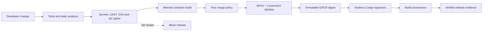

# DevSecOps Engineering Portfolio

[](https://github.com/kiplongu/devsecops-engineering-portfolio/actions/workflows/security.yml)
[](LICENSE)

A compact, runnable reference showing how I design security into software
delivery: policy-driven CI, reusable infrastructure, vulnerability remediation,
software supply-chain evidence and human-reviewed AI assistance.

This repository is an original public implementation. It contains no private
application code, customer data, production credentials or exported pipeline
history. The sample service exists only to give every control a real artifact
to test, scan, package and attest.

## Architecture



## What this proves

| Capability | Evidence in this repository |
|---|---|
| Secure CI/CD | [GitHub Actions pipeline](.github/workflows/security.yml), final fail-closed gate |
| SAST and workflow analysis | CodeQL for Go and GitHub Actions |
| Secret prevention | Gitleaks across full Git history |
| Dependency governance | Dependency Review and Dependabot |
| Container security | Multi-stage scratch image and Trivy filesystem/image gates |
| Infrastructure as code | [Reusable Kubernetes baseline](terraform/modules/kubernetes-baseline) and isolated environments |
| Vulnerability management | [Detection → prioritization → remediation → rescan → verification](docs/VULNERABILITY-MANAGEMENT.md) |
| Supply-chain security | Dual-format SBOMs, keyless Cosign signing, digest verification and provenance |
| Jenkins delivery | [Production-style declarative reference](Jenkinsfile) with equivalent controls |
| AI-assisted security | [Offline-first triage](tools/ai-triage) with deterministic authority and mandatory human review |

## Run locally

Requirements: Docker. Go 1.27.3+, Python 3.11+, Terraform, Trivy, Gitleaks and
Syft are useful for the complete workstation validation but CI installs its own
toolchain.

```bash
make test
make vulnerability-demo
docker build -t portfolio:local .
docker run --rm -p 8080:8080 portfolio:local
```

Or use the hardened local runtime profile (read-only filesystem, all Linux
capabilities dropped, no privilege escalation and resource limits):

```bash
docker compose up --build
```

In a second terminal:

```bash
curl -fsS http://127.0.0.1:8080/healthz
curl -fsS -X POST http://127.0.0.1:8080/api/v1/triage \
  -H 'Content-Type: application/json' \
  --data @tools/ai-triage/sample-finding.json
```

The vulnerability lifecycle is intentionally testable:

```bash
# Demonstrates that the original high-risk state is blocked.
python3 scripts/vulnerability_gate.py security/findings/before.json --expect-block

# Demonstrates that remediated findings pass and evidence is complete.
python3 scripts/vulnerability_gate.py security/findings/current.json
python3 scripts/verify_remediation.py \
  security/findings/before.json security/findings/current.json
```

## Secure release

Merging is not releasing. A semantic tag starts the separate supply-chain
workflow:

```bash
git tag -s v0.1.0 -m 'Release v0.1.0'
git push origin v0.1.0
```

The workflow builds once, pushes an immutable digest, scans that exact digest,
generates SPDX and CycloneDX SBOMs, signs with GitHub OIDC via Sigstore, verifies
the signature, attaches provenance, and only then publishes a release.

## Repository guide

- [Architecture and trust boundaries](docs/ARCHITECTURE.md)
- [GitHub Actions controls](docs/GITHUB-ACTIONS.md)
- [Jenkins reference implementation](docs/JENKINS.md)
- [Terraform environments](docs/TERRAFORM.md)
- [Vulnerability management lifecycle](docs/VULNERABILITY-MANAGEMENT.md)
- [Supply-chain verification](docs/SUPPLY-CHAIN.md)
- [AI-assisted security design](docs/AI-ASSISTED-SECURITY.md)
- [Validation record and honest boundaries](docs/VALIDATION.md)
- [Recruiter evidence map](docs/RECRUITER-EVIDENCE.md)

## Scope and boundaries

The repository validates controls without provisioning paid infrastructure.
Terraform plans require a deliberately selected Kubernetes context before
apply. The Jenkinsfile is syntax-reviewable and runnable on a controller with
the documented plugins/tools, but this repo does not claim a public Jenkins
controller. Keyless signing and GitHub provenance run only on a tagged GitHub
release because they require a trusted OIDC identity.

## Security

Use the private process in [SECURITY.md](SECURITY.md). Never test these examples
against systems you do not own or have explicit permission to assess.
