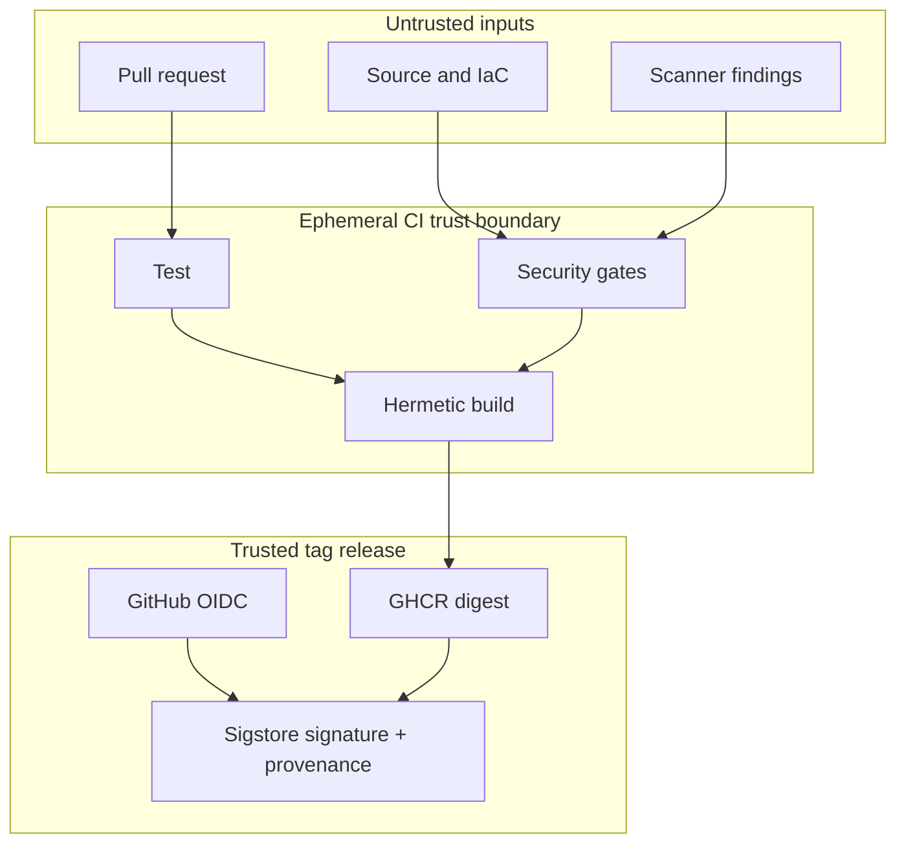

# Architecture and threat model

The sample API is deliberately small: Go standard library, no runtime package
dependencies, bounded request bodies, strict JSON decoding, timeouts, security
headers and a non-root scratch container. Its purpose is to make the delivery
controls concrete without hiding them behind application complexity.

## Trust boundaries

Pull requests never receive package-write or OIDC privileges. The ordinary
pipeline is read-only except for CodeQL results and ephemeral artifacts. Only a
version tag enters the release boundary. Secrets are not used for signing;
GitHub issues a short-lived identity token and the signature is bound to the
repository workflow identity.

## Fail-closed behavior

Independent jobs reduce time-to-feedback, but the final gate explicitly checks
every required result. A failed, cancelled, or missing test/security job blocks
the pipeline. Dependency Review is allowed to be skipped only outside pull
requests, where no dependency diff exists.
